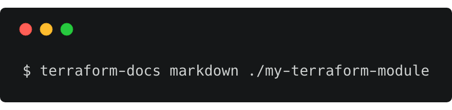

# terraform-docs

[](https://github.com/terraform-docs/terraform-docs/actions) [](https://pkg.go.dev/github.com/terraform-docs/terraform-docs) [](https://goreportcard.com/report/github.com/terraform-docs/terraform-docs) [](https://codecov.io/gh/terraform-docs/terraform-docs) [](https://github.com/terraform-docs/terraform-docs/blob/master/LICENSE) [](https://github.com/terraform-docs/terraform-docs/releases) [](https://www.bestpractices.dev/projects/3500)



## What is terraform-docs

A utility to generate documentation from Terraform modules in various output formats.

## Installation

macOS users can install using [Homebrew]:

```bash
brew install terraform-docs
```

or

```bash
brew install terraform-docs/tap/terraform-docs
```

Windows users can install using [Scoop]:

```bash
scoop bucket add terraform-docs https://github.com/terraform-docs/scoop-bucket
scoop install terraform-docs
```

or [Chocolatey]:

```bash
choco install terraform-docs
```

Stable binaries are also available on the [releases] page. To install, download the
binary for your platform from "Assets" and place this into your `$PATH`:

```bash
curl -Lo ./terraform-docs.tar.gz https://github.com/terraform-docs/terraform-docs/releases/download/v0.24.0/terraform-docs-v0.24.0-$(uname)-amd64.tar.gz
tar -xzf terraform-docs.tar.gz
chmod +x terraform-docs
mv terraform-docs /usr/local/bin/terraform-docs
```

**NOTE:** Windows releases are in `ZIP` format.

The latest version can be installed using `go install` or `go get`:

```bash
# go1.17+
go install github.com/terraform-docs/terraform-docs@v0.24.0
```

```bash
# go1.16
GO111MODULE="on" go get github.com/terraform-docs/terraform-docs@v0.24.0
```

**NOTE:** please use the latest Go to do this, minimum `go1.16` is required.

This will put `terraform-docs` in `$(go env GOPATH)/bin`. If you encounter the error
`terraform-docs: command not found` after installation then you may need to either add
that directory to your `$PATH` as shown [here] or do a manual installation by cloning
the repo and run `make build` from the repository which will put `terraform-docs` in:

```bash
$(go env GOPATH)/src/github.com/terraform-docs/terraform-docs/bin/$(uname | tr '[:upper:]' '[:lower:]')-amd64/terraform-docs
```

## Usage

### Running the binary directly

To run and generate documentation into README within a directory:

```bash
terraform-docs markdown table --output-file README.md --output-mode inject /path/to/module
```

Check [`output`] configuration for more details and examples.

### Using docker

terraform-docs can be run as a container by mounting a directory with `.tf`
files in it and run the following command:

```bash
docker run --rm --volume "$(pwd):/terraform-docs" -u $(id -u) quay.io/terraform-docs/terraform-docs:0.24.0 markdown /terraform-docs
```

If `output.file` is not enabled for this module, generated output can be redirected
back to a file:

```bash
docker run --rm --volume "$(pwd):/terraform-docs" -u $(id -u) quay.io/terraform-docs/terraform-docs:0.24.0 markdown /terraform-docs > doc.md
```

**NOTE:** Docker tag `latest` refers to _latest_ stable released version and `edge`
refers to HEAD of `master` at any given point in time.

### Using GitHub Actions

To use terraform-docs GitHub Action, configure a YAML workflow file (e.g.
`.github/workflows/documentation.yml`) with the following:

```yaml
name: Generate terraform docs
on:
  - pull_request

jobs:
  docs:
    runs-on: ubuntu-latest
    steps:
    - uses: actions/checkout@v3
      with:
        ref: ${{ github.event.pull_request.head.ref }}

    - name: Render terraform docs and push changes back to PR
      uses: terraform-docs/gh-actions@main
      with:
        working-dir: .
        output-file: README.md
        output-method: inject
        git-push: "true"
```

Read more about [terraform-docs GitHub Action] and its configuration and
examples.

### pre-commit hook

With pre-commit, you can ensure your Terraform module documentation is kept
up-to-date each time you make a commit.

First [install pre-commit] and then create or update a `.pre-commit-config.yaml`
in the root of your Git repo with at least the following content:

```yaml
repos:
  - repo: https://github.com/terraform-docs/terraform-docs
    rev: "v0.24.0"
    hooks:
      - id: terraform-docs-go
        args: ["markdown", "table", "--output-file", "README.md", "./mymodule/path"]
```

Then run:

```bash
pre-commit install
pre-commit install-hooks
```

Further changes to your module's `.tf` files will cause an update to documentation
when you make a commit.

## Configuration

terraform-docs can be configured with a yaml file. The default name of this file is
`.terraform-docs.yml` and the path order for locating it is:

1. root of module directory
1. `.config/` folder at root of module directory
1. current directory
1. `.config/` folder at current directory
1. `$HOME/.tfdocs.d/`

```yaml
formatter: "" # this is required

version: ""

header-from: main.tf
footer-from: ""

recursive:
  enabled: false
  path: modules
  include-main: true

sections:
  hide: []
  show: []

content: ""

output:
  file: ""
  mode: inject
  template: |-
    <!-- BEGIN_TF_DOCS -->
    {{ .Content }}
    <!-- END_TF_DOCS -->

output-values:
  enabled: false
  from: ""

sort:
  enabled: true
  by: name

settings:
  anchor: true
  color: true
  default: true
  description: false
  escape: true
  hide-empty: false
  html: true
  indent: 2
  lockfile: true
  read-comments: true
  required: true
  sensitive: true
  type: true
```

## Content Template

Generated content can be customized further away with `content` in configuration.
If the `content` is empty the default order of sections is used.

Compatible formatters for customized content are `asciidoc` and `markdown`. `content`
will be ignored for other formatters.

`content` is a Go template with following additional variables:

- `{{ .Header }}`
- `{{ .Footer }}`
- `{{ .Inputs }}`
- `{{ .Modules }}`
- `{{ .Outputs }}`
- `{{ .Providers }}`
- `{{ .Requirements }}`
- `{{ .Resources }}`

and following functions:

- `{{ include "relative/path/to/file" }}`

These variables are the generated output of individual sections in the selected
formatter. For example `{{ .Inputs }}` is Markdown Table representation of _inputs_
when formatter is set to `markdown table`.

Note that sections visibility (i.e. `sections.show` and `sections.hide`) takes
precedence over the `content`.

Additionally there's also one extra special variable available to the `content`:

- `{{ .Module }}`

As opposed to the other variables mentioned above, which are generated sections
based on a selected formatter, the `{{ .Module }}` variable is just a `struct`
representing a [Terraform module].

````yaml
content: |-
  Any arbitrary text can be placed anywhere in the content

  {{ .Header }}

  and even in between sections

  {{ .Providers }}

  and they don't even need to be in the default order

  {{ .Outputs }}

  include any relative files

  {{ include "relative/path/to/file" }}

  {{ .Inputs }}

  # Examples

  ```hcl
  {{ include "examples/foo/main.tf" }}
  ```

  ## Resources

  {{ range .Module.Resources }}
  - {{ .GetMode }}.{{ .Spec }} ({{ .Position.Filename }}#{{ .Position.Line }})
  {{- end }}
````

## Build on top of terraform-docs

terraform-docs primary use-case is to be utilized as a standalone binary, but
some parts of it is also available publicly and can be imported in your project
as a library.

```go
import (
    "github.com/terraform-docs/terraform-docs/format"
    "github.com/terraform-docs/terraform-docs/print"
    "github.com/terraform-docs/terraform-docs/terraform"
)

// buildTerraformDocs for module root `path` and provided content `tmpl`.
func buildTerraformDocs(path string, tmpl string) (string, error) {
    config := print.DefaultConfig()
    config.ModuleRoot = path // module root path (can be relative or absolute)

    module, err := terraform.LoadWithOptions(config)
    if err != nil {
        return "", err
    }

    // Generate in Markdown Table format
    formatter := format.NewMarkdownTable(config)

    if err := formatter.Generate(module); err != nil {
        return "", err
    }

    // // Note: if you don't intend to provide additional template for the generated
    // // content, or the target format doesn't provide templating (e.g. json, yaml,
    // // xml, or toml) you can use `Content()` function instead of `Render()`.
    // // `Content()` returns all the sections combined with predefined order.
    // return formatter.Content(), nil

    return formatter.Render(tmpl)
}
```

## Plugin

Generated output can be heavily customized with [`content`], but if using that
is not enough for your use-case, you can write your own plugin.

In order to install a plugin the following steps are needed:

- download the plugin and place it in `~/.tfdocs.d/plugins` (or `./.tfdocs.d/plugins`)
- make sure the plugin file name is `tfdocs-format-<NAME>`
- modify [`formatter`] of `.terraform-docs.yml` file to be `<NAME>`

**Important notes:**

- if the plugin file name is different than the example above, terraform-docs won't
be able to to pick it up nor register it properly
- you can only use plugin thorough `.terraform-docs.yml` file and it cannot be used
with CLI arguments

To create a new plugin create a new repository called `tfdocs-format-<NAME>` with
following `main.go`:

```go
package main

import (
    _ "embed" //nolint

    "github.com/terraform-docs/terraform-docs/plugin"
    "github.com/terraform-docs/terraform-docs/print"
    "github.com/terraform-docs/terraform-docs/template"
    "github.com/terraform-docs/terraform-docs/terraform"
)

func main() {
    plugin.Serve(&plugin.ServeOpts{
        Name:    "<NAME>",
        Version: "0.1.0",
        Printer: printerFunc,
    })
}

//go:embed sections.tmpl
var tplCustom []byte

// printerFunc the function being executed by the plugin client.
func printerFunc(config *print.Config, module *terraform.Module) (string, error) {
    tpl := template.New(config,
        &template.Item{Name: "custom", Text: string(tplCustom)},
    )

    rendered, err := tpl.Render("custom", module)
    if err != nil {
        return "", err
    }

    return rendered, nil
}
```

Please refer to [tfdocs-format-template] for more details. You can create a new
repository from it by clicking on `Use this template` button.

## Documentation

- **Users**
  - Read the [User Guide] to learn how to use terraform-docs
  - Read the [Formats Guide] to learn about different output formats of terraform-docs
  - Refer to [Config File Reference] for all the available configuration options
- **Developers**
  - Read [Contributing Guide] before submitting a pull request

Visit [our website] for all documentation.

## Community

- Discuss terraform-docs on [Slack]

## License

MIT License - Copyright (c) 2021 The terraform-docs Authors.

[Chocolatey]: https://www.chocolatey.org
[Config File Reference]: https://terraform-docs.io/user-guide/configuration/
[`content`]: https://terraform-docs.io/user-guide/configuration/content/
[Contributing Guide]: CONTRIBUTING.md
[Formats Guide]: https://terraform-docs.io/reference/terraform-docs/
[`formatter`]: https://terraform-docs.io/user-guide/configuration/formatter/
[here]: https://golang.org/doc/code.html#GOPATH
[Homebrew]: https://brew.sh
[install pre-commit]: https://pre-commit.com/#install
[`output`]: https://terraform-docs.io/user-guide/configuration/output/
[releases]: https://github.com/terraform-docs/terraform-docs/releases
[Scoop]: https://scoop.sh/
[Slack]: https://slack.terraform-docs.io/
[terraform-docs GitHub Action]: https://github.com/terraform-docs/gh-actions
[Terraform module]: https://pkg.go.dev/github.com/terraform-docs/terraform-docs/terraform#Module
[tfdocs-format-template]: https://github.com/terraform-docs/tfdocs-format-template
[our website]: https://terraform-docs.io/
[User Guide]: https://terraform-docs.io/user-guide/introduction/


## 🌐 Web Resources & Interactive Index
- [CATEGORY SIDE SCROLLING184](https://enskillcrafts.pages.dev/category-side-scrolling184.html)
- [CATEGORY TURN BASED30](https://studyplaying.github.io/category-turn-based30.html)
- [ULTIMATE DESTRUCTION SIMULATOR](https://studyplaying.github.io/ultimate-destruction-simulator.html)
- [VSCO GIRL AESTHETIC](https://themindzone.pages.dev/vsco-girl-aesthetic.html)
- [BUBBLE PLOPPER](https://studyplaying.github.io/bubble-plopper.html)
- [EUROPE AT WAR](https://studyplayings.web.app/europe-at-war.html)
- [GEOMETRY ARROW 2](https://learnquester.github.io/geometry-arrow-2.html)
- [BOSS MARKET](https://studyplaying.github.io/boss-market.html)
- [MERGE CUBES 2048 3D](https://studyplaying.github.io/merge-cubes-2048-3d.html)
- [COSMIC TETRIZ PUZZLES](https://studyplaying.github.io/cosmic-tetriz-puzzles.html)
- [BUBBLE SHOOTER FREE 3](https://studyplaying.github.io/bubble-shooter-free-3.html)
- [MINI GRAND THEFT CITY](https://studyplayings.web.app/mini-grand-theft-city.html)
- [GTA CAR RUSH](https://studyplaying.github.io/gta-car-rush.html)
- [CATEGORY PUZZLE 6](https://learnquester.pages.dev/category-puzzle-6.html)
- [CATEGORY MAKEUP CATEGORY](https://studyplayings.web.app/category-makeup-category.html)
- [DEFENDERS OF THE REALM AN EPIC WAR](https://studyplaying.github.io/defenders-of-the-realm-an-epic-war.html)
- [CATEGORY MATCH 3 2](https://studyplaying.github.io/category-match-3-2.html)
- [SPACE SHOOTER SPEED TYPING CHALLENGE](https://studyplaying.github.io/space-shooter-speed-typing-challenge.html)
- [CATEGORY MAGIC46](https://learnquester.pages.dev/category-magic46.html)
- [CATEGORY LINKS](https://learnquester.pages.dev/category-links.html)
- [NUMBER COLLECTOR BRAINTEASER](https://thelearnquester.web.app/number-collector-brainteaser.html)
- [SLIME RUSH](https://thelearnquester.web.app/slime-rush.html)
- [TILE SORT MATCH 3](https://studyplaying.github.io/tile-sort-match-3.html)
- [BEST FRIENDS PUZZLE](https://studyplaying.github.io/best-friends-puzzle.html)
- [CARD MASTER](https://learnquester.github.io/card-master.html)
- [ULTIMATE ROBO DUEL 3D](https://learnquester.github.io/ultimate-robo-duel-3d.html)
- [HOSPITAL GAME HAPPY CLINIC](https://studyplaying.github.io/hospital-game-happy-clinic.html)
- [CATEGORY PUZZLE 4](https://studyplayings.pages.dev/category-puzzle-4.html)
- [PARKOUR BLOCK 6](https://studyplayings.web.app/parkour-block-6.html)
- [CATEGORY PHYSICS371](https://studyplaying.github.io/category-physics371.html)
- [GOON BALL](https://studyplayings.pages.dev/goon-ball.html)
- [CATEGORY UNBLOCKED GAMES](https://thelearnquester.web.app/category-unblocked-games.html)
- [TROPICAL MATCH 2](https://studyplayings.pages.dev/tropical-match-2.html)
- [EASTER SHADOW MATCH](https://learnquester.github.io/easter-shadow-match.html)
- [SUNNY LINK](https://studyplayings.pages.dev/sunny-link.html)
- [WITCHY AND THE PUZZLE ADVENTURES](https://studyplaying.github.io/witchy-and-the-puzzle-adventures.html)
- [ANIMAL LINK](https://studyplaying.github.io/animal-link.html)
- [PET DOCTOR BUSINESS TYCOON PET CARE GAME](https://thelearnquester.web.app/pet-doctor-business-tycoon-pet-care-game.html)
- [POPPING PETS](https://learnquester.github.io/popping-pets.html)
- [CATEGORY STICKMAN 2](https://studyplaying.github.io/category-stickman-2.html)
- [ARCHERY MASTER BOW AND ARROW](https://studyplaying.github.io/archery-master-bow-and-arrow.html)
- [CATEGORY MOBILE2 095](https://studyplaying.github.io/category-mobile2-095.html)
- [CATEGORY PUZZLE 10](https://studyplaying.github.io/category-puzzle-10.html)
- [FREE THE BALL](https://studyplaying.github.io/free-the-ball.html)
- [FRAY FIGHT](https://studyplaying.github.io/fray-fight.html)
- [BREAKTHROUGH TEAM](https://thelearnquester.web.app/breakthrough-team.html)
- [CATEGORY RUNNING107](https://studyplayings.pages.dev/category-running107.html)
- [POPPY PLAYER PUZZLE](https://studyplayings.pages.dev/poppy-player-puzzle.html)
- [CATEGORY PIXEL313](https://studyplayings.web.app/category-pixel313.html)
- [TRUCKTOPOLIS COOKING CHAOS](https://learnquester.github.io/trucktopolis-cooking-chaos.html)
- [WORLDGUESSR](https://studyplaying.github.io/worldguessr.html)
- [CATEGORY MINIGAMES29](https://studyplaying.github.io/category-minigames29.html)
- [CATEGORY UNBLOCKED](https://studyplaying.github.io/category-unblocked.html)
- [CATEGORY RACING DRIVING](https://studyplaying.github.io/category-racing-driving.html)
- [MINE 2D SURVIVAL HEROBRINE](https://studyplaying.github.io/mine-2d-survival-herobrine.html)
- [DOTS MASTER](https://studyplaying.github.io/dots-master.html)
- [CATEGORY SHOOTER 3](https://studyplaying.github.io/category-shooter-3.html)
- [DROP KICK WORLD CUP 2018](https://studyplayings.web.app/drop-kick-world-cup-2018.html)
- [CATEGORY STORY45](https://studyplayings.pages.dev/category-story45.html)
- [RACE TIME](https://studyplaying.github.io/race-time.html)
- [QUEENS ROYAL SUDOKU PUZZLE](https://studyplayings.web.app/queens-royal-sudoku-puzzle.html)
- [CATEGORY MAHJONG](https://studyplayings.pages.dev/category-mahjong.html)
- [CAT PANCAKE DINER](https://studyplaying.github.io/cat-pancake-diner.html)
- [JET FIGHTER AIRPLANE RACING](https://studyplaying.github.io/jet-fighter-airplane-racing.html)
- [PUZZLE PLAY](https://studyplayings.pages.dev/puzzle-play.html)
- [ICE FISHING 3D](https://studyplayings.web.app/ice-fishing-3d.html)
- [CATEGORY RACING DRIVING](https://studyplayings.web.app/category-racing-driving.html)
- [TURBO RACE 3D](https://learnquester.github.io/turbo-race-3d.html)
- [CATEGORY HORROR](https://studyplaying.github.io/category-horror.html)
- [2048 MATCH BALLS](https://studyplayings.web.app/2048-match-balls.html)
- [MOTO ROAD RASH 3D 2](https://thelearnquester.web.app/moto-road-rash-3d-2.html)
- [CATEGORY UNBLOCKED GAMES](https://iskillquest.pages.dev/category-unblocked-games.html)
- [HERITAGE MAHJONG CLASSIC](https://iskillquest.pages.dev/heritage-mahjong-classic.html)
- [CUTE CATS ADVENTURES](https://thelearnquester.web.app/cute-cats-adventures.html)
- [CLEAN THE OCEAN](https://iskillquest.pages.dev/clean-the-ocean.html)
- [CATEGORY PUZZLE 3](https://iskillquest.pages.dev/category-puzzle-3.html)
- [LITTLE LILY HALLOWEEN PREP](https://studyplayings.web.app/little-lily-halloween-prep.html)
- [CATEGORY MATCH 3117](https://iskillquest.pages.dev/category-match-3117.html)
- [OBBY DRAW TO ESCAPE](https://iskillquest.pages.dev/obby-draw-to-escape.html)
- [CATEGORY PHYSICS371](https://iskillquest.pages.dev/category-physics371.html)
- [CATEGORY SHOOTER 2](https://thelearnquester.web.app/category-shooter-2.html)
- [QUIZ X](https://themindplay.pages.dev/quiz-x.html)
- [OBBY SURVIVE PARKOUR](https://studyplaying.github.io/obby-survive-parkour.html)
- [MAX CRUSHER 2 DESTRUCTION DRIFT AND RACING](https://themindplay.pages.dev/max-crusher-2-destruction-drift-and-racing.html)
- [CATEGORY FOOTBALL](https://iskillquest.pages.dev/category-football.html)
- [PHONE CASE DIY 5](https://thelearnquester.web.app/phone-case-diy-5.html)
- [MONSTER SCHOOL VS SIREN HEAD](https://studyplaying.github.io/monster-school-vs-siren-head.html)
- [MR DRIFTER CAR CHASE SIMULATOR](https://iskillquest.pages.dev/mr-drifter-car-chase-simulator.html)
- [CATEGORY OBSTACLE299](https://iskillquest.pages.dev/category-obstacle299.html)
- [HYPER NURSE HOSPITAL GAMES](https://studyplaying.github.io/hyper-nurse-hospital-games.html)
- [SWIM GOOD](https://quizverses.github.io/swim-good.html)
- [COLOR SCREW RESCUE PUZZLE](https://studyplayings.web.app/color-screw-rescue-puzzle.html)
- [CATEGORY DRESS UP97](https://quizverses.github.io/category-dress-up97.html)
- [ANIMAL MERGE BUBBLE SHOOTER](https://themindplay.pages.dev/animal-merge-bubble-shooter.html)
- [FOREST MATCH 4](https://studyplaying.github.io/forest-match-4.html)
- [MR RECKLESS CAR CHASE SIMULATOR](https://iskillquest.pages.dev/mr-reckless-car-chase-simulator.html)
- [GLOVES OF BLOCK](https://iskillquest.pages.dev/gloves-of-block.html)
- [QUBE 2048 ELF](https://quizverses.github.io/qube-2048-elf.html)
- [CAT VS GRANNY CAT SIMULATOR](https://theskillquest.pages.dev/cat-vs-granny-cat-simulator.html)
- [LIGHT LINE](https://theskillquest.pages.dev/light-line.html)
- [CATEGORY JIGSAW](https://studyquests.github.io/category-jigsaw.html)
- [ALIEN HUNTERS](https://studyquests.github.io/alien-hunters.html)
- [CATEGORY PUZZLE 4](https://studyplaying.github.io/category-puzzle-4.html)
- [MY TINY LAND](https://studyquests.github.io/my-tiny-land.html)
- [DICE FUSION](https://learnquester.github.io/dice-fusion.html)
- [QUIZ X](https://iskillquest.pages.dev/quiz-x.html)
- [HOLE BATTLEIO](https://thelearnquester.web.app/hole-battleio.html)
- [HEX SENSE](https://studyplaying.github.io/hex-sense.html)
- [MONSTER TRUCK CRUSH](https://themindplay.github.io/monster-truck-crush.html)
- [DRAGON YEAR JIGSAW](https://studyplaying.github.io/dragon-year-jigsaw.html)
- [CELEBRITY AESTHETIC CHALLENGE](https://studyquesthub.web.app/celebrity-aesthetic-challenge.html)
- [ROYAL FAMILY TREE](https://iskillquest.pages.dev/royal-family-tree.html)
- [HILL CLIMBING MANIA](https://learnquester.github.io/hill-climbing-mania.html)
- [CATEGORY INCREMENTAL](https://themindplay.github.io/category-incremental.html)
- [CATEGORY EDUCATIONAL](https://learnquester.pages.dev/category-educational.html)
- [CATEGORY CASUAL 3](https://quizverses.github.io/category-casual-3.html)
- [MERGE HEROES TITANS](https://themindplay.pages.dev/merge-heroes-titans.html)
- [TINY CARS](https://studyplaying.github.io/tiny-cars.html)
- [EMOJI SMASHER SMILEY GAME](https://theskillquest.pages.dev/emoji-smasher-smiley-game.html)
- [FUNNY RAGDOLL WRESTLERS](https://iskillquest.pages.dev/funny-ragdoll-wrestlers.html)
- [CATEGORY SANDBOX](https://iskillquest.pages.dev/category-sandbox.html)
- [ATOMIC MERGE 2048](https://themindplay.pages.dev/atomic-merge-2048.html)
- [GEOMETRIX](https://studyplaying.github.io/geometrix.html)
- [CATEGORY PUZZLE 2](https://iskillquest.pages.dev/category-puzzle-2.html)
- [HIDDEN OBJECT MY HOTEL](https://iskillquest.pages.dev/hidden-object-my-hotel.html)
- [BAD EGG](https://iskillquest.pages.dev/bad-egg.html)
- [SANDBOX ISLAND WAR](https://themindplay.pages.dev/sandbox-island-war.html)
- [DESIGNVILLE MERGE DESIGN](https://iskillquest.pages.dev/designville-merge-design.html)
- [MATCH DREAM GARDEN](https://theskillquest.pages.dev/match-dream-garden.html)
- [ONLINE PORTAL](https://brainquests-fb2c5.web.app/)
